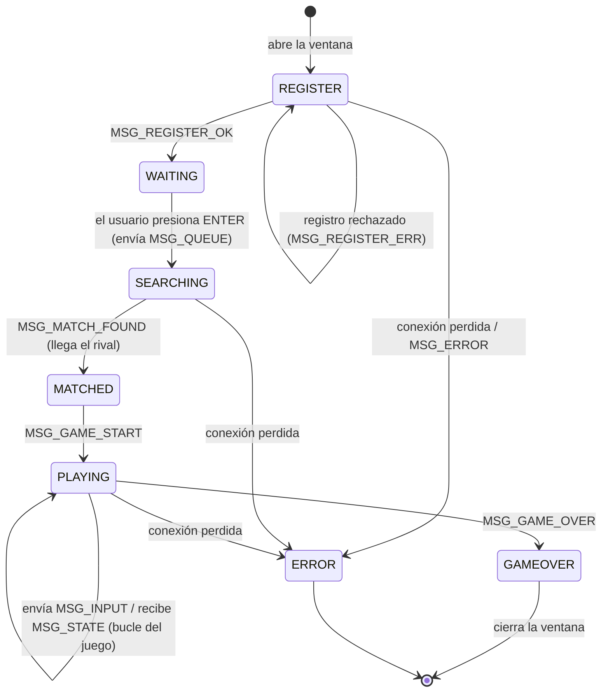

# Diagrama de estados del cliente — MyAppGameProtocol

**Fase 9 · UML**

Este diagrama muestra los estados por los que pasa la aplicación cliente
(`client/src/main.py`) y qué mensaje del protocolo provoca cada transición.
Complementa el diagrama de secuencia de [`SECUENCIA.md`](SECUENCIA.md).

El cliente siempre está en UN estado a la vez. Un estado solo acepta ciertas
acciones; por ejemplo, no se puede enviar `MSG_INPUT` si no se está jugando.

## Qué pasa en cada estado

| Estado | Qué hace el cliente | Cómo sale |
|--------|---------------------|-----------|
| **REGISTER** | Muestra la pantalla de registro; el usuario escribe nickname y email | Al recibir `MSG_REGISTER_OK` pasa a WAITING; si hay error, se queda para reintentar |
| **WAITING** | Ya registrado; espera a que el usuario pida jugar | Al presionar ENTER envía `MSG_QUEUE` y pasa a SEARCHING |
| **SEARCHING** | Muestra "Buscando rival..."; el servidor lo tiene en cola | Al recibir `MSG_MATCH_FOUND` pasa a MATCHED |
| **MATCHED** | Muestra el nick del rival y el lado asignado | Al recibir `MSG_GAME_START` pasa a PLAYING |
| **PLAYING** | Captura las teclas (envía `MSG_INPUT`) y dibuja el estado (`MSG_STATE`) con el score | Al recibir `MSG_GAME_OVER` pasa a GAMEOVER |
| **GAMEOVER** | Muestra el resultado de la partida | El usuario cierra la ventana |
| **ERROR** | Muestra el error (conexión perdida o `MSG_ERROR` del servidor) | El usuario cierra la ventana |

## Reglas que refuerza el diagrama

1. **No se puede saltar estados.** No se envía `MSG_INPUT` si no se está en
   PLAYING; el servidor además lo rechaza con `MSG_ERROR` si alguien lo intenta.
2. **El servidor manda, el cliente dibuja.** En PLAYING el cliente nunca calcula
   física: solo envía la tecla y pinta el `MSG_STATE` que llega.
3. **Cualquier estado puede caer a ERROR** si se pierde la conexión, sin que la
   aplicación se cierre de golpe.
